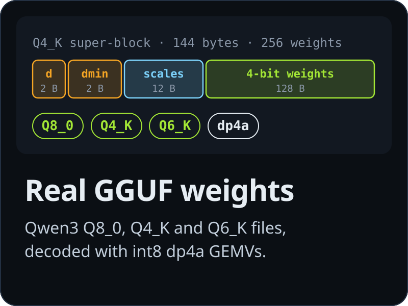
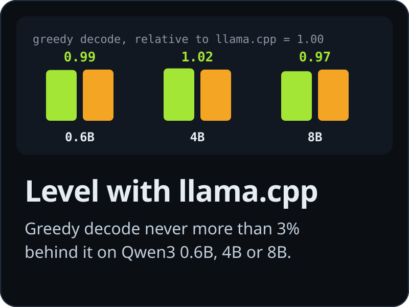
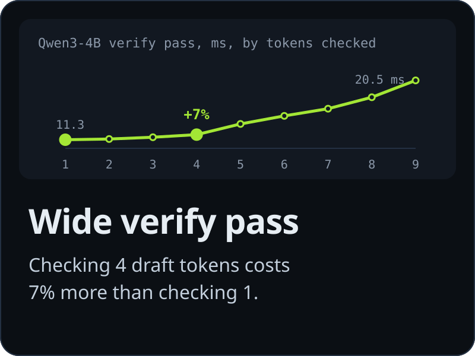
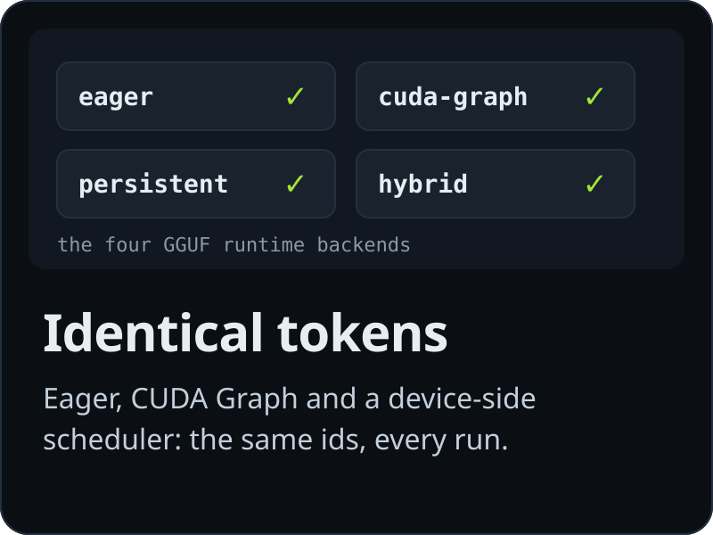
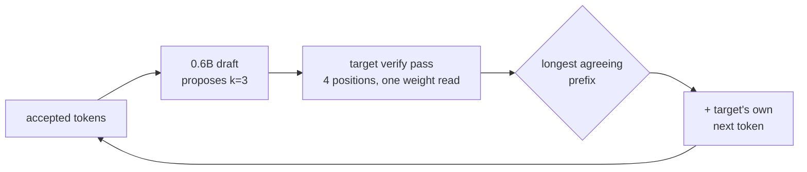

<a id="readme-top"></a>

# 🍗 kernel-sanders

**AdaKernel: a hand-written CUDA runtime for Qwen3 GGUF models on one 8 GB RTX 4060.**<br>
Research project · every number measured on one consumer GPU · full write-up in [`docs/RESULTS.md`](docs/RESULTS.md)

<p>
  
  
  
  
  
</p>

<p align="center">
  
</p>

AdaKernel loads Qwen3 GGUF files (Q8_0, Q4_K, Q6_K) straight from disk and decodes them with int8 dp4a GEMVs and fused decode ops. Plain greedy decode is never more than 3% behind llama.cpp, and speculative decoding with a Qwen3-0.6B draft runs **1.18–1.44× faster than llama.cpp's `llama-speculative`** on the same models.

**Why it matters:** at batch 1, an 8 GB card is limited by memory bandwidth, not math. Qwen3-8B Q4_K_M reads 4.67 GB of weights for every token. The only way past that wall is to read the weights fewer times per token, and that's what the verify pass does.

**Quick links:** [Demo](#-demo) · [Features](#-features) · [Results](#-results) · [How it works](#-how-it-works) · [Quick Start](#-quick-start) · [Project Structure](#-project-structure) · [Configuration](#-configuration) · [Testing](#-testing) · [Future Extensions](#-future-extensions)

<p align="center"></p>

## 🎬 Demo

<p align="center">
  <a href=".github/readme/brag.mp4"></a>
  <br>
  <sub>▶ Click for the full 22-second video with sound. Every figure in it is from <a href="docs/RESULTS.md"><code>docs/RESULTS.md</code></a>.</sub>
</p>

<!-- For an inline player: drag .github/readme/brag.mp4 into the GitHub README editor and paste the user-attachments URL here. -->

## ✨ Features

<p align="center">
  
  
</p>
<p align="center">
  
  
</p>

- **Direct GGUF loading.** Qwen3 0.6B, 4B and 8B run from the official GGUF files, including the tied Q6_K embedding/output in the 4B file.
- **Bandwidth-level quantized GEMVs.** The activation is quantized once to 32-value int8 blocks, then dotted against 16-byte weight loads with `__dp4a`. Projections reach 234 GB/s on 8B, which is 86% of the card's 272 GB/s theoretical bandwidth. The old float-dequant kernels reached 65 GB/s.
- **Fused decode ops.** Residual + RMSNorm + quantize, QK-norm + RoPE + KV write, warp-per-key attention that writes int8, SiLU + quantize, and a split argmax.
- **Greedy speculative decoding.** The draft proposes k tokens, and `ak_gguf_verify` checks k + 1 positions in one pass that reads every weight matrix once. The longest agreeing prefix is kept, plus the target's own next token.
- **Four execution backends on one set of device functions:** eager, CUDA Graph, a persistent device-side DAG scheduler, and that scheduler captured in a graph. A difference in tokens is treated as a bug.
- **Layer offload** for synthetic models larger than VRAM: the layers that don't fit sit in pinned host memory and are copied into a scratch arena before use.
- **Checked against references.** 0.6B logits are within 1.8% relative L2 of a NumPy FP32 forward pass, with the same argmax. 4B greedy text matches llama.cpp token for token over 32 tokens.

<p align="right"><a href="#readme-top">↑ back to top</a></p>

## 📊 Results

<p align="center">
  
</p>

**Plain greedy decode, tok/s.** 128 tokens, median of 5, measured back to back with `llama-bench -p 0 -n 128 -ngl 99 -fa 1` in the same session.

| Model | llama.cpp tg128 | AdaKernel cuda-graph | eager | hybrid | ratio |
| --- | --- | --- | --- | --- | --- |
| Qwen3-0.6B Q8_0 | 276.8 | 274.5 | 243.5 | 171.0 | 0.99 |
| Qwen3-4B Q4_K_M | 84.4 | **86.3** | 82.1 | 66.8 | 1.02 |
| Qwen3-8B Q4_K_M | **49.9** | 48.3 | 47.1 | 42.3 | 0.97 |

**Speculative decoding with the Qwen3-0.6B Q8_0 draft.** Speedup over plain greedy on the same target, CUDA Graph backend, mean of four prompts (story, explain, code, facts), 128 tokens, median of 3.

| Target | greedy tok/s | k=2 | k=3 | k=4 | k=5 | k=6 | k=8 |
| --- | --- | --- | --- | --- | --- | --- | --- |
| Qwen3-8B Q4_K_M | 48.9 | 1.62× | **1.76×** | 1.72× | 1.65× | 1.69× | 1.46× |
| Qwen3-4B Q4_K_M | 87.5 | 1.28× | **1.36×** | 1.31× | 1.20× | 1.27× | 1.11× |

8B gains more than 4B because a 0.6B draft step (about 3.5 ms) is a smaller share of its 20 ms step than of 4B's 11.5 ms one.

> [!NOTE]
> llama.cpp's own numbers moved 9–14% between sessions with GPU clock state, so only ratios measured in the same session are comparable. The speculative comparison is with `llama-speculative` (`--spec-draft-n-max 3 -ngl 99 -ngld 99 -fa on --temp 0`), llama.cpp's example program. llama-server's speculative path was not measured.

<details>
<summary><b>Verify-pass cost by width, and what didn't work</b></summary>

Verify-pass cost against T, the number of tokens checked at once, in ms:

| Model | T=1 | 2 | 3 | 4 | 5 | 6 | 7 | 8 | 9 |
| --- | --- | --- | --- | --- | --- | --- | --- | --- | --- |
| 4B | 11.33 | 11.44 | 11.71 | 12.12 | 13.77 | 15.01 | 16.12 | 17.89 | 20.50 |
| 8B | 20.34 | 20.47 | 20.89 | 21.56 | 23.90 | 26.37 | 28.61 | 31.96 | 36.36 |

Null results:

- The persistent scheduler is the slowest backend on real models. Each task costs about 0.5 µs of atomics, and that outweighs the overlap once the kernels are fast. Its wins on synthetic models were against slow FP32 kernels.
- Half-warp rows for the K-quant GEMV made no difference in interleaved A/B runs. An earlier "200 → 220 GB/s" was clock drift.
- Merging Q+K and gate+up into single GEMV launches gave no gain above session noise. They were kept, because there are fewer launches and the tokens are the same.
- Elementwise fusion does not move decode on the medium synthetic model.

</details>

<p align="right"><a href="#readme-top">↑ back to top</a></p>

## 🧠 How it works

**Decoder.** One token at a time through a Qwen3 decoder: token embedding, then for each layer RMSNorm, Q/K/V projections, per-head QK RMSNorm, NeoX RoPE, KV append, grouped-query attention, output projection, residual, SwiGLU, residual. Then the final RMSNorm, the vocabulary projection and a greedy argmax.

**One speculative round:**



The wide verify GEMVs are capped at 64 registers. Before the cap, Q4_K at T ≥ 6 used 183–191 registers, and T=6 cost 18.97 ms on 4B instead of 15.01.

**Quantized weight blocks** (llama.cpp layouts):

| Format | Block | Bytes | Weights |
| --- | --- | --- | --- |
| Q8_0 | FP16 scale + 32 int8 values | 34 | 32 |
| Q4_K | FP16 `d` and `dmin`, 12 bytes of 6-bit scales and mins, 128 bytes of nibbles | 144 | 256 |
| Q6_K | 128 bytes low bits, 64 bytes high bits, 16 bytes of scales, FP16 `d` | 210 | 256 |

**Backends.** Every backend runs the same device functions.

| Backend | What one token does |
| --- | --- |
| eager | One CUDA launch per task, in task-id order, on one stream |
| cuda-graph | That same launch sequence, captured once and replayed |
| persistent | One reset kernel plus one persistent kernel that walks the task DAG |
| hybrid | The reset kernel and the persistent kernel captured as a CUDA Graph |
| fused | Eager, with residual+RMSNorm fused into one task (synthetic runtime) |
| cublas / cublas-graph | One cuBLAS SGEMV per projection instead of row chunks (synthetic runtime) |

**The persistent scheduler.** The host builds a DAG whose edges always point from an earlier task id to a later one. The kernel launches only as many blocks as can stay resident: 96 blocks of 256 threads on the 4060. Each block claims a ticket with `atomicAdd` and waits for that slot's ready flag. The last predecessor of a task publishes it with an atomic decrement and a threadfence. There is no `grid.sync()`. KV length and the sampled token live in device memory, so the captured graph doesn't bake in a sequence length.

<p align="right"><a href="#readme-top">↑ back to top</a></p>

## 🔩 Hardware

Every measurement comes from one machine (recorded in `configs/hardware.yaml`):

| Part | Spec |
| --- | --- |
| GPU | NVIDIA GeForce RTX 4060, 8 GB, Ada (sm_89), 24 SMs, driver 621.14 |
| Memory | 128-bit bus, 272 GB/s theoretical, 246 GB/s measured with a float4 copy |
| L2 | 24 MB |
| Host | Ryzen 5 7600X, 32 GB RAM, Windows 11 |
| Link | PCIe 3.0 x8 |

## 🚀 Quick Start

### Prerequisites

- An NVIDIA Ada GPU (sm_89). `nvcc` from CUDA 11.2 cannot target it.
- Windows 11 with Visual Studio 2022 Build Tools
- conda, which installs a user-local CUDA 12.8 toolkit with no administrator rights or driver changes
- Python 3.12 for the virtualenv (the package itself needs 3.10+)

### Installation

```powershell
git clone https://github.com/omer-chandna/kernel-sanders.git
cd kernel-sanders
powershell -ExecutionPolicy Bypass -File scripts\setup_windows.ps1   # .venv + CUDA 12.8 in .conda-cuda
powershell -ExecutionPolicy Bypass -File scripts\build.ps1           # builds build\adakernel.dll
.\.venv\Scripts\python.exe -m adakernel doctor
```

The CUDA 13.5 system installer needs administrator approval, so this tree uses the conda toolkit under `.conda-cuda` instead. `build.ps1` refuses a toolkit that does not contain `bin\nvcc.exe`. `doctor` reports the platform, GPU and loaded DLL, and writes them to `configs/hardware.yaml`.

**Models.** Put GGUF files in `models\` (not tracked by git). The benchmarks default to `Qwen3-0.6B-Q8_0.gguf`, `Qwen3-4B-Q4_K_M.gguf` and `Qwen3-8B-Q4_K_M.gguf` from the official Qwen GGUF releases. Tokenizing and the llama.cpp comparisons use a separately built llama.cpp under `third_party/llama.cpp`, which is a pinned upstream checkout and not vendored into git.

### Basic usage

```powershell
# real Qwen3 models: every backend, plus llama-bench in the same session
.\.venv\Scripts\python.exe -m benchmarks.gguf_bench --model models\Qwen3-4B-Q4_K_M.gguf

# speculative decoding with the 0.6B draft, checked against plain greedy
.\.venv\Scripts\python.exe -m benchmarks.spec_bench --target models\Qwen3-8B-Q4_K_M.gguf --ks 3

# synthetic FP32 decoder
.\.venv\Scripts\python.exe -m adakernel init-model --output models\tiny.npz
.\.venv\Scripts\python.exe -m adakernel generate --model models\tiny.npz --backend persistent --prompt-tokens 1,5,9,3 -n 16
```

> [!WARNING]
> `--prompt` on a synthetic `.npz` model is mapped to token ids with a non-linguistic hash. It does not run a Qwen tokenizer. Pass `--prompt-tokens` when the ids matter.

### API usage

```python
from adakernel.gguf import GgufModel, tokenize

target_path = "models/Qwen3-8B-Q4_K_M.gguf"
with GgufModel(target_path) as target, GgufModel("models/Qwen3-0.6B-Q8_0.gguf") as draft:
    ids = tokenize(target_path, "The capital of France is")

    greedy = target.generate(ids, 128, backend="cuda-graph")
    spec = target.speculate(draft, ids, n_gen=128, n_draft=3)

    assert spec["tokens"].tolist() == greedy["tokens"].tolist()
    print(greedy["decode_tps"], spec["decode_tps"], spec["acceptance"])
    print(target.profile())  # GPU ms per op for one eager step
```

<p align="right"><a href="#readme-top">↑ back to top</a></p>

## 📁 Project Structure

```text
kernel-sanders/
├── adakernel/
│   ├── __main__.py        # CLI: doctor, init-model, generate
│   ├── gguf.py            # GgufModel: load, generate, verify, speculate, profile; tokenizer helpers
│   ├── native.py          # ctypes bindings to adakernel.dll
│   └── reference.py       # NumPy decoder, the correctness target for logits
├── native/
│   ├── cuda/
│   │   ├── gguf_model.cu  # Qwen3 GGUF runtime: loader, decode, verify, speculative loop
│   │   ├── qgemv.cuh      # int8-activation dp4a GEMVs for Q8_0 / Q4_K / Q6_K
│   │   ├── decode_ops.cuh # fused residual+norm+quantize, QK-norm+RoPE+KV, attention, argmax
│   │   ├── megakernel.cu  # persistent device-side DAG scheduler
│   │   ├── engine.cu      # synthetic FP32 model runtime and offload
│   │   ├── prefill.cu     # prefill path
│   │   └── bench.cu, qwen35_bench.cu, test_api.cu
│   └── quant_cpu.cpp      # CPU block layouts and quantizers for Q8_0 / Q4_K / Q6_K
├── include/adakernel/api.h  # C API
├── benchmarks/            # gguf_bench, spec_bench, kernel/inference/memory benches, run_all
├── tests/                 # kernels, model, quantization, GGUF
├── experiments/           # capacity probe, scheduler sweep, debug scripts, EXPERIMENT_LOG.md
├── configs/               # benchmarks.yaml, experiments.yaml, hardware.yaml
├── docs/                  # ARCHITECTURE, EXPERIMENTS, OPTIMIZATIONS, RESULTS, NEXT_STEPS
├── scripts/               # setup_windows.ps1, build.ps1
└── CMakeLists.txt         # sm_89, links cuBLAS + cudart
```

## 🔧 Configuration

`configs/benchmarks.yaml` sets the shapes, repetitions and correctness tolerances (excerpt):

```yaml
inference:
  shapes: [tiny, small, medium]
  generated_tokens: 32
  prompt_tokens: 16
  repetitions: 5
  warmup: 1
memory:
  n_gpu_layers: [4, 2, 1, 0]
tolerances:
  fp32_kernel_atol: 1.0e-4
  q4k_matvec_atol: 1.0e-4
  model_logit_atol: 2.0e-3
```

`configs/experiments.yaml` drives `benchmarks.run_all`: shapes, kernel iterations, repetitions and the backend list. `configs/hardware.yaml` is the device report from `adakernel doctor`.

## 📦 Output Files

Benchmarks write JSON under `experiments/results/`, which is not tracked by git:

| File | Written by |
| --- | --- |
| `gguf_<model>.json` | `benchmarks.gguf_bench --output` |
| `spec_<model>.json` | `benchmarks.spec_bench --output` |
| `kernel_bench.json`, `inference_bench.json`, `memory_bench.json` | the matching bench (default `--output`) |
| `hardware.json` | `adakernel doctor` |
| `*.log` + JSON per stage | `benchmarks.run_all` |

## 💻 Command-Line Options

<details>
<summary><b>adakernel and benchmark flags</b></summary>

| Command | Options |
| --- | --- |
| `python -m adakernel doctor` | none |
| `python -m adakernel init-model` | `--output` (required), `--config` |
| `python -m adakernel generate` | `--model`, `--backend {eager,cuda-graph,persistent,hybrid,fused,cublas,cublas-graph}`, `--prompt`, `--prompt-tokens`, `-n` (16), `--n-gpu-layers` |
| `benchmarks.gguf_bench` | `--model`, `--prompt`, `--n-gen` (128), `--reps` (5), `--backends`, `--no-llama`, `--output` |
| `benchmarks.spec_bench` | `--target`, `--draft`, `--n-gen` (128), `--ks` (2,3,4,5,6,8), `--reps` (3), `--output` |
| `benchmarks.kernel_bench` | `--rows`, `--k`, `--seq`, `--heads`, `--iters`, `--warmup`, `--output` |
| `benchmarks.inference_bench` | `--shapes`, `--backends`, `--n-gen`, `--reps`, `--warmup`, `--output` |
| `benchmarks.memory_bench` | `--output` |
| `benchmarks.run_all` | `--config`, `--output`, `--smoke` |

</details>

## 🧪 Testing

```powershell
.\.venv\Scripts\python.exe -m pytest tests -q
```

There are 23 test functions across kernels, the synthetic model, quantization and GGUF. The GGUF tests check:

- that the backends agree
- logits against the NumPy reference
- verify-pass output against step-by-step decode
- that speculative decoding reproduces greedy tokens

They skip themselves when `models/Qwen3-0.6B-Q8_0.gguf` is missing (or the 4B file, for the 4B test).

## 🔬 Background

<details>
<summary><b>Synthetic-model findings (the FP32 runtime this started as)</b></summary>

The first runtime generates tokens for a synthetic Qwen-style decoder and compares eager CUDA launches, CUDA Graphs, fused elementwise kernels and the persistent scheduler on the same FP32 model.

On that model, the persistent DAG scheduler is faster than replaying the same kernels through a CUDA Graph for single-token decode (1153 vs 159 tok/s on the medium model), because independent Q, K, V, gate and up projections run at the same time. A CUDA Graph is faster than the persistent scheduler for a serial chain of empty kernels: 0.58 µs vs 1.76 µs per kernel. Elementwise fusion does not move medium-model decode. Streaming every layer of a 36 MB model across PCIe 3.0 x8 cuts decode from 380 to 116 tok/s with identical tokens.

</details>

The optimization log in [`docs/OPTIMIZATIONS.md`](docs/OPTIMIZATIONS.md) records each change with its hypothesis, its measurement, and whether it was kept.

## 🔭 Future Extensions

From [`docs/NEXT_STEPS.md`](docs/NEXT_STEPS.md):

- **Sampling-based acceptance.** Temperature and top-p need rejection sampling, not prefix match.
- **Adaptive k** from recent acceptance. k=6 wins on predictable text, and k=2–3 on prose.
- **Batched prefill** with a quantized GEMM. Prompts currently go through the decode graph one token at a time.
- **Long context:** an f16 or int8 KV cache and split-K attention.
- **A cheaper persistent scheduler:** batched successor publication and work-stealing GEMV tiles.

## 📚 Docs

[RESULTS](docs/RESULTS.md) · [ARCHITECTURE](docs/ARCHITECTURE.md) · [EXPERIMENTS](docs/EXPERIMENTS.md) · [OPTIMIZATIONS](docs/OPTIMIZATIONS.md) · [NEXT_STEPS](docs/NEXT_STEPS.md) · [EXPERIMENT_LOG](experiments/EXPERIMENT_LOG.md)

<p align="center"></p>
