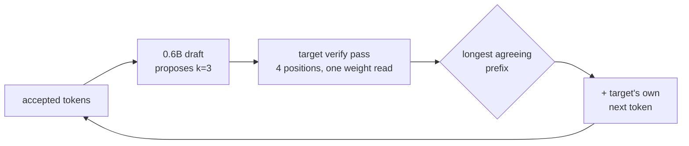

<a id="readme-top"></a>

<p align="center">
  
</p>

<p align="center">
  <b>AdaKernel</b> is a hand-written CUDA runtime that loads Qwen3 GGUF files directly on an 8 GB RTX 4060,
  decodes about as fast as llama.cpp, and runs speculative decoding 18–44% faster than llama.cpp's <code>llama-speculative</code>.
</p>

<p align="center">
  
  
  
  
</p>

<p align="center">
  <a href="#results">Results</a> ·
  <a href="#quickstart">Quickstart</a> ·
  <a href="#usage">Usage</a> ·
  <a href="#how-it-works">How it works</a> ·
  <a href="docs/RESULTS.md">Full write-up</a>
</p>

<br>

<p align="center">
  <a href="docs/RESULTS.md#table-f-speculative-decoding-qwen3-06b-q8_0-drafting"></a>
</p>

## Why

At batch 1, decode on an 8 GB card is a memory-bandwidth problem: Qwen3-8B Q4_K_M reads 4.67 GB of weights per token, and the 4060 moves 272 GB/s. AdaKernel's dp4a GEMVs reach about 230 GB/s, which keeps plain decode no more than 3% behind llama.cpp (ahead on 4B). The bigger win is reading those weights fewer times per token. A 0.6B draft proposes three tokens, and the target checks all four positions in one pass over its weights. That pass costs 7% more than checking one. Every speculative run reproduces the target's plain greedy tokens exactly.

```python
from adakernel.gguf import GgufModel, tokenize

target_path = "models/Qwen3-8B-Q4_K_M.gguf"
with GgufModel(target_path) as target, GgufModel("models/Qwen3-0.6B-Q8_0.gguf") as draft:
    ids = tokenize(target_path, "The capital of France is")
    out = target.speculate(draft, ids, n_gen=128, n_draft=3)  # same tokens as greedy
    print(out["decode_tps"], out["acceptance"])
```

<p align="center"></p>

## What's inside

<p align="center">
  
  
</p>
<p align="center">
  
  
</p>

- **Fused decode ops.** Residual + RMSNorm + int8 quantize, QK-norm + RoPE + KV write, attention that writes int8, SiLU + quantize, and a split argmax. On 0.6B, where matrices are small, these are why the CUDA Graph path keeps pace with llama.cpp.
- **A persistent device-side scheduler.** One kernel walks a task DAG with atomics, with no `grid.sync()`. It beats CUDA Graph replay on the synthetic FP32 models and loses to it on real checkpoints, and [the write-up](docs/RESULTS.md) says why.
- **Checked against references.** On 0.6B, logits after the prompt are within 1.8% relative L2 of a NumPy FP32 forward pass, with the same argmax. Greedy 4B text matches llama.cpp token for token over 32 tokens.

<p align="center"></p>

## Results

Measured on the machine described in [`docs/EXPERIMENTS.md`](docs/EXPERIMENTS.md): RTX 4060 8 GB (Ada, sm_89), Ryzen 5 7600X, 32 GB RAM, Windows 11, PCIe 3.0 x8.

**Plain greedy decode, tok/s.** 128 tokens, median of 5, measured back to back with `llama-bench -p 0 -n 128 -ngl 99 -fa 1`.

| Model | llama.cpp tg128 | AdaKernel cuda-graph | ratio |
| --- | --- | --- | --- |
| Qwen3-0.6B Q8_0 | 276.8 | 274.5 | 0.99 |
| Qwen3-4B Q4_K_M | 84.4 | **86.3** | 1.02 |
| Qwen3-8B Q4_K_M | **49.9** | 48.3 | 0.97 |

**Speculative decoding with the 0.6B draft.** Speedup over plain greedy on the same target, mean of four prompts.

| Target | greedy tok/s | k=2 | k=3 | k=4 | k=6 | k=8 |
| --- | --- | --- | --- | --- | --- | --- |
| Qwen3-8B Q4_K_M | 48.9 | 1.62x | **1.76x** | 1.72x | 1.69x | 1.46x |
| Qwen3-4B Q4_K_M | 87.5 | 1.28x | **1.36x** | 1.31x | 1.27x | 1.11x |

> [!NOTE]
> llama.cpp's own numbers moved 9–14% between sessions with GPU clock state, so only ratios measured in the same session are comparable. The comparison is with `llama-speculative`, llama.cpp's example program. llama-server's speculative path was not measured.

<details>
<summary><b>What didn't work</b></summary>

- The persistent scheduler is the slowest backend on real models. Each task costs about 0.5 µs of atomics, and that outweighs the overlap once the kernels are fast. Its wins in Table C were against slow FP32 kernels on synthetic models.
- Half-warp rows for the K-quant GEMV: no difference in interleaved A/B runs. An earlier "200 → 220 GB/s" was clock drift.
- Merging Q+K and gate+up into single GEMV launches: no gain above session noise. Kept, because there are fewer launches and the tokens are the same.
- Elementwise fusion does not move decode on the medium synthetic model.

</details>

Kernel microbenchmarks, the backend matrix on synthetic models, offload costs, scheduler sweeps and the verify-pass curve are all in [`docs/RESULTS.md`](docs/RESULTS.md).

<p align="right"><a href="#readme-top">↑ back to top</a></p>

<p align="center"></p>

## Quickstart

> [!IMPORTANT]
> This is a Windows + NVIDIA project. It needs an Ada GPU (sm_89), Visual Studio 2022 Build Tools, conda, and Python 3.12 (the package itself needs 3.10+). `nvcc` from CUDA 11.2 cannot target sm_89.

The CUDA 13.5 system installer needs administrator approval. This tree instead uses a user-local CUDA 12.8 toolkit under `.conda-cuda` (created by the conda command in `scripts/setup_windows.ps1`) and a Python virtualenv in `.venv`.

```powershell
git clone https://github.com/omer-chandna/kernel-sanders.git
cd kernel-sanders
powershell -ExecutionPolicy Bypass -File scripts\setup_windows.ps1
powershell -ExecutionPolicy Bypass -File scripts\build.ps1
.\.venv\Scripts\python.exe -m pytest tests -q
.\.venv\Scripts\python.exe -m adakernel doctor
```

`build.ps1` produces `build\adakernel.dll` and refuses a toolkit that does not contain `bin\nvcc.exe`.

**For real models**, put the GGUF files in `models\` (not tracked by git). The benchmarks default to `Qwen3-0.6B-Q8_0.gguf`, `Qwen3-4B-Q4_K_M.gguf` and `Qwen3-8B-Q4_K_M.gguf`, from the official Qwen GGUF releases. Tokenizing and the llama.cpp comparisons use a llama.cpp build under `third_party/llama.cpp`. That checkout is pinned upstream and not vendored into git, and it is built separately.

## Usage

**Real Qwen3 GGUF models**

```powershell
.\.venv\Scripts\python.exe -m benchmarks.gguf_bench --model models\Qwen3-4B-Q4_K_M.gguf
.\.venv\Scripts\python.exe -m benchmarks.spec_bench --target models\Qwen3-8B-Q4_K_M.gguf --ks 3
```

`gguf_bench` decodes 128 greedy tokens on every backend and runs `llama-bench` in the same session (`--no-llama` skips it). `spec_bench` runs four prompts and checks every speculative run against plain greedy tokens.

**Synthetic FP32 decoder**

```powershell
.\.venv\Scripts\python.exe -m benchmarks.kernel_bench
.\.venv\Scripts\python.exe -m benchmarks.inference_bench
.\.venv\Scripts\python.exe -m benchmarks.run_all --smoke
.\.venv\Scripts\python.exe -m adakernel init-model --output models\tiny.npz
.\.venv\Scripts\python.exe -m adakernel generate --model models\tiny.npz --backend persistent --prompt-tokens 1,5,9,3 -n 16
```

Backends: `eager`, `cuda-graph`, `fused`, `persistent`, `hybrid`, `cublas`, `cublas-graph`.

> [!WARNING]
> `--prompt` on a synthetic `.npz` model is mapped to token ids with a non-linguistic hash. It does not run a Qwen tokenizer. Pass `--prompt-tokens` when the ids matter.

<p align="center"></p>

## How it works

One speculative round on the CUDA Graph path:



`ak_gguf_verify` reads every weight matrix once for all columns. The wide GEMV variants are capped at 64 registers with `__launch_bounds__(128, 8)`. Before the cap, Q4_K at T ≥ 6 used 183–191 registers.

Every backend runs the same device functions, so the math is the same. A difference in tokens is treated as a bug.

| Backend | What one token does |
| --- | --- |
| eager | One CUDA launch per task, in task-id order, on one stream |
| cuda-graph | That same launch sequence, captured once and replayed |
| fused | Eager schedule with residual+RMSNorm fused into one task (synthetic runtime) |
| cublas | One cuBLAS SGEMV per projection instead of row chunks (synthetic runtime) |
| persistent | One reset kernel plus one persistent kernel that walks the task DAG |
| hybrid | The reset kernel and the persistent kernel captured as a CUDA Graph |

The persistent kernel launches only as many blocks as can stay resident (96 blocks of 256 threads on the 4060). Each block claims a ticket with `atomicAdd`, waits for that task's predecessors, and publishes successors with atomic decrements. Details in [`docs/ARCHITECTURE.md`](docs/ARCHITECTURE.md).

<details>
<summary><b>Synthetic-model findings (FP32 runtime)</b></summary>

The first runtime generates tokens for a synthetic Qwen-style decoder (RMSNorm, QK-norm, NeoX RoPE, grouped-query attention, SwiGLU) and compares eager CUDA launches, CUDA Graphs, fused elementwise kernels, and the persistent device-side task scheduler on the same FP32 model.

On this 4060, a persistent DAG scheduler is faster than replaying the same kernels through a CUDA Graph for single-token decode on those models, because independent projections run at the same time. A CUDA Graph is faster than the persistent scheduler for a serial chain of empty kernels. Elementwise fusion does not move medium-model decode. The FP32-runtime Q4_K and Q8_0 matvec kernels match their dequantized reference and are slower than FP32 cuBLAS GEMV. The GGUF runtime replaced them with the dp4a GEMVs in `native/cuda/qgemv.cuh`.

</details>

## Layout

```text
adakernel/          Python package, ctypes bindings, NumPy reference
native/cuda/        kernels, persistent scheduler, model runtimes (gguf_model.cu, qgemv.cuh, decode_ops.cuh)
include/adakernel/  C API
benchmarks/         measurement scripts
tests/              correctness tests
experiments/        sweep and debug scripts, experiment log (raw JSON and plots are not tracked)
configs/            benchmark, experiment and hardware configs
docs/               architecture, method, measured results, next steps
third_party/llama.cpp   pinned upstream checkout, not vendored into git
```

## Docs

- [`docs/RESULTS.md`](docs/RESULTS.md): every measured number, including the ones that went the wrong way
- [`docs/ARCHITECTURE.md`](docs/ARCHITECTURE.md): tasks, backends, the persistent scheduler, offload
- [`docs/EXPERIMENTS.md`](docs/EXPERIMENTS.md): hardware and method
- [`docs/OPTIMIZATIONS.md`](docs/OPTIMIZATIONS.md): what was tried
- [`docs/NEXT_STEPS.md`](docs/NEXT_STEPS.md): sampling-based acceptance, batched prefill, long context

<p align="center"></p>
